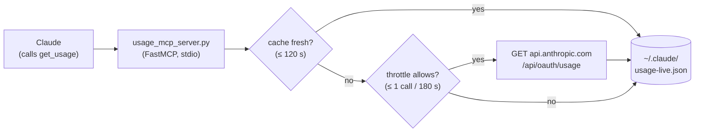

<div align="center">

# 📊 usage-mcp

**Let Claude check your Claude usage limits — mid-conversation.**

The same 5-hour and weekly percentages that `/usage` shows, exposed as an MCP tool,
so you can just ask *"how much usage do I have left?"* and Claude looks it up itself.


</div>

---

## ✨ Why

`/usage` is great, but Claude itself can't see it. That means Claude can't pace a long
task, warn you before you hit a wall, or tell you whether there's room for one more big
refactor before the window resets.

With **usage-mcp** installed, Claude gets a `get_usage` tool and can answer things like:

> **You:** Do I have enough usage left to run the full test-suite migration?
>
> **Claude:** *(calls `get_usage`)* You're at **42%** of your 5-hour window (resets in
> **4h 8m**) and **15%** of your weekly limit. Plenty of room. Starting now.

It works in the **VS Code extension** too, where the terminal status line isn't rendered.

---

## 🚀 Install

### The easy way: let your agent do it

Clone the repo, open it in Claude Code (or any coding agent), and say:

```
Follow SETUP.md to install this for me.
```

[`SETUP.md`](SETUP.md) is written **for the agent**. It checks your Python, installs
the dependency, registers the MCP server with the right absolute paths for your OS,
and verifies everything end-to-end.

### The manual way

**Requirements:** Python 3.10+ and [Claude Code](https://claude.com/claude-code), logged
in with a Claude subscription (Pro / Max / Team). API-key-only logins have no usage limits to show.

```bash
# 1. Clone
git clone https://github.com/dmytrochygarov/usage-mcp.git
cd usage-mcp

# 2. Install the one dependency
python -m pip install -r requirements.txt

# 3. Sanity check: should print JSON with five_hour / seven_day percentages
python usage_cli.py

# 4. Register with Claude Code (user scope = available in every project)
#    Use ABSOLUTE paths for both the Python interpreter and the server script.
claude mcp add usage --scope user -- "$(python -c 'import sys;print(sys.executable)')" "$(pwd)/usage_mcp_server.py"
```

<details>
<summary><b>Windows (PowerShell) version of step 4</b></summary>

```powershell
$py = python -c "import sys; print(sys.executable)"
claude mcp add usage --scope user -- $py "$PWD\usage_mcp_server.py"
```

</details>

Then run `claude mcp list`. You should see `usage: ... ✔ Connected`. Start a fresh
session (or run `/mcp` to reconnect) and ask Claude about your usage.

---

## 🧠 How it works



1. Claude Code already stores your OAuth login: `~/.claude/.credentials.json` on
   Windows/Linux, and the **login Keychain** on macOS.
2. On a tool call, usage-mcp serves a small local cache if it's fresh. Otherwise it
   makes **one read-only GET** to the same usage endpoint `/usage` uses.
3. Calls are throttled (max 1 per 180 s, plus a 15-min backoff after any HTTP 429), so
   bursts of questions never hammer the endpoint.
4. If anything fails (offline, expired token, throttled), it **degrades to the last
   cached snapshot** with a note instead of erroring.

| File | Role |
|------|------|
| `usage_core.py` | All the logic. Stdlib only. |
| `usage_mcp_server.py` | MCP server: one tool, `get_usage(force_refresh=False)`. |
| `usage_cli.py` | Same data from the terminal: `python usage_cli.py [--fresh]`. |

### Example output

```json
{
  "source": "oauth-api",
  "data_age_seconds": 0,
  "stale": false,
  "five_hour":  { "used_percentage": 42.0, "resets_in": "4h 8m" },
  "seven_day":  { "used_percentage": 15.0, "resets_in": "1d 16h" },
  "seven_day_scoped": [
    { "model": "Fable", "used_percentage": 10.0, "resets_in": "6d 22h" }
  ]
}
```

`seven_day_scoped` lists per-model weekly caps (what `/usage` calls "Weekly Fable",
etc.). It's empty when your plan has none active.

---

## 🔒 Safety

- **Read-only.** It only ever performs a single `GET` on the usage endpoint.
- **Your token never leaves the request.** It's used solely for the `Authorization`
  header and is never logged, printed, returned to Claude, or written to the cache.
- **No token refresh logic.** On a 401 it just serves the cache and lets Claude Code
  refresh its own login.
- **Nothing sensitive in the repo.** The cache and throttle state live in `~/.claude/`.

---

## ⚙️ Configuration

All optional, via environment variables (pass them with `claude mcp add -e KEY=VALUE`):

| Variable | Default | Meaning |
|----------|---------|---------|
| `USAGE_STALE_SECONDS` | `120` | Cache older than this triggers a live pull. |
| `USAGE_API_MIN_INTERVAL` | `180` | Minimum seconds between live pulls. |
| `USAGE_API_429_COOLDOWN` | `900` | Backoff after an HTTP 429. |
| `CLAUDE_CONFIG_DIR` | `~/.claude` | Claude Code's config dir (respected if you've moved it). |
| `USAGE_CREDENTIALS_PATH` | `<config dir>/.credentials.json` | OAuth credentials file. |
| `USAGE_KEYCHAIN_SERVICE` | `Claude Code-credentials` | macOS Keychain item name. |
| `USAGE_CACHE_PATH` / `USAGE_STATE_PATH` | `<config dir>/usage-*.json` | Cache / throttle-state files. |

---

## 🩺 Troubleshooting

| Symptom | Fix |
|---------|-----|
| `credentials not readable` | Run `claude` and log in with your Claude account (`/login`). On macOS, allow the Keychain prompt the first time. |
| `HTTP 401` note | Your token expired. Use Claude Code normally for a moment; it refreshes itself. |
| `live refresh throttled; serving cache` | Expected. Wait ~3 minutes for fresh numbers. |
| `HTTP 429` note | Backed off for 15 min automatically. Nothing to do. |
| Tool not showing up in Claude | `claude mcp list`. Check both paths are absolute, then start a new session or `/mcp`. |
| `ModuleNotFoundError: mcp` | `mcp` was installed into a different Python than the one you registered. Re-run step 2 with that exact interpreter. |

---

## ⚠️ Disclaimer

This is an unofficial community tool, not affiliated with Anthropic. It relies on an
**undocumented** endpoint that Claude Code itself uses, which may change without notice.

## 📄 License

[MIT](LICENSE) © Dmytro Chygarov
